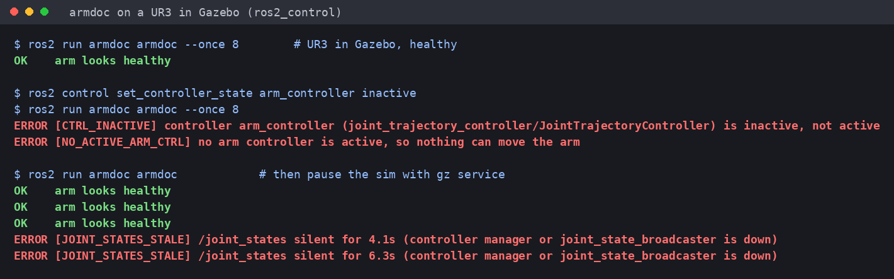
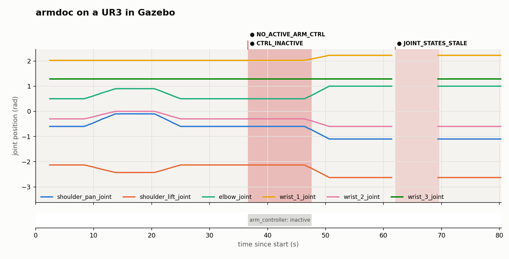

# armdoc

[](https://github.com/darshmenon/armdoc/actions/workflows/ci.yml) [](https://github.com/darshmenon/armdoc/releases) [](LICENSE) 

**Why isn't my arm moving?** Attach to a running ros2_control / MoveIt 2 arm and get a one-line cause. Read-only: it subscribes to topics and lists controllers, and never publishes or changes anything.

## Quick start

```bash
ros2 run armdoc armdoc --ready                              # pre-flight check: READY / NOT READY, with a next step for each problem
ros2 launch armdoc armdoc.launch.py ns:=/ur3 moveit:=true   # live: a report every 2 s (drop ns / moveit if you don't use them)
docker run --rm armdoc                                      # no robot? try it on a fake arm (build it first, see below)
```

**Install** into a ROS 2 workspace (Humble tested):

```bash
cd ~/ros2_ws/src && git clone https://github.com/darshmenon/armdoc.git
cd .. && colcon build --packages-select armdoc && source install/setup.bash
```

**Docker** (nothing else to install; the demo runs a healthy fake arm, then a stalled one, then a fake MoveIt with no planning scene):

```bash
docker build -t armdoc https://github.com/darshmenon/armdoc.git
docker run --rm armdoc                                                  # the demo
docker run --rm --net=host -e ROS_DOMAIN_ID=0 armdoc armdoc --ready     # check a running arm on this machine
```

More ways to run it:

```bash
ros2 run armdoc armdoc --ns /ur3 --moveit   # namespaced arm, also check move_group and the planning scene
ros2 run armdoc armdoc --once 10            # watch 10 s, print one report, exit 1 on any ERROR (for CI)
ros2 run armdoc armdoc --diagnostics        # also publish findings to /diagnostics (opt-in, see below)
```

```
ERROR [CTRL_INACTIVE] controller arm_controller (joint_trajectory_controller/JointTrajectoryController) is inactive, not active
ERROR [TRAJ_STALLED] a trajectory goal has been active for 10s but the joints moved 0.0000 rad
```



*Real output from a UR3 in Gazebo: healthy, then the arm controller deactivated, then the sim paused while armdoc was attached. Source: `docs/ur3_gazebo_demo.txt`, `docs/make_screenshot.py`.*

## What it checks

| Code | Level | Means |
|---|---|---|
| `JOINT_STATES_NONE` / `JOINT_STATES_STALE` | error | no `/joint_states`, or it went silent (broadcaster or controller manager down) |
| `JOINT_NAN` | error | a joint position is NaN/inf (diverged controller) |
| `NEAR_LIMIT` / `LIMIT_POS` | warn / error | within 1% of a URDF joint limit, or outside it |
| `LIMIT_VEL` | warn | joint faster than its URDF velocity limit |
| `EFFORT_SAT` | warn | a joint pinned at its effort limit for 2 s (contact or payload) |
| `NO_CONTROLLER_MANAGER` | warn | `list_controllers` does not answer |
| `CTRL_INACTIVE` / `NO_ACTIVE_ARM_CTRL` | error | an arm controller is not active, or none is |
| `NO_MOVE_GROUP` | error | `--moveit` and no `move_group` node |
| `NO_PLANNING_SCENE` | warn | `--moveit`, `move_group` is up, but nothing publishes `/monitored_planning_scene` and `/get_planning_scene` is not served |
| `MOVEIT_PLAN_FAILED` | warn | `--moveit` and a `/move_action` goal was aborted in the last 30 s |
| `TRACKING_ERROR` | warn | trajectory controller error above 0.05 rad for 3 s |
| `TRAJ_STALLED` | error | a `follow_joint_trajectory` goal is executing but the joints are not moving |
| `NOISY_JOINTS` | warn | position jitter above 0.002 rad (estimated over 1 s, at 20 Hz or faster): encoder or driver noise |
| `STREAM_LAG` | warn | `/joint_states` arrive more than 0.5 s after their header stamp, so the controller and planner see old data |
| `GOAL_ABORTS` | warn | 3 or more trajectory goals aborted or cancelled within 30 s |

How the new checks work, and what they cannot see:

- **`NOISY_JOINTS`** takes the fourth difference of each arm joint's positions (white noise of sigma s gives a standard deviation of about 8.4 s; smooth motion cancels out, even a fast sine). It treats samples as evenly spaced, so heavy timing jitter at high joint speed can raise the estimate, and it stays silent below 20 Hz. A sudden step in the data (for example a stream that was delayed catching up) shows up as one report. Tune with `--noise-rad`.
- **`STREAM_LAG`** compares a message's header stamp with the time it arrives, using the median of the last 2 s. When the stamps are simulation time, run armdoc with `--ros-args -p use_sim_time:=true`, otherwise the two clocks differ by years and the check stays silent on purpose. A source that restamps old data is invisible to it. Tune with `--lag-max`.
- **`MOVEIT_PLAN_FAILED`** counts goals that went to ABORTED on `/move_action/_action/status` after armdoc attached; goals that finished before that are history, judged by the goal's own timestamp. It cannot tell you why planning failed, only that it did.
- **`NO_PLANNING_SCENE`** looks for a publisher on `/monitored_planning_scene` or a `/get_planning_scene` service rather than waiting for a message, because MoveIt publishes the scene only when it changes.

Limits come from `/robot_description`, and are checked only for joints that arm controllers claim (grippers and broadcasters are skipped). Missing-thing checks wait out a startup grace (`--grace`, 20 s).

## Parameters and launch

`ros2 launch armdoc armdoc.launch.py` takes `ns`, `moveit`, `diagnostics`, `use_sim_time` and `params_file` (default `config/armdoc.yaml`). The thresholds in that file are ROS parameters of the `armdoc` node: `period`, `hints`, `stale`, `grace`, `track_err`, `stall_time`, `noise_rad`, `lag_max`. They also work without the launch file:

```bash
ros2 run armdoc armdoc --ros-args --params-file my_thresholds.yaml
```

Parameters win over the matching command-line flags. `--once`, `--ready`, `--json` and `--record` are command-line only.

## `/diagnostics` (opt-in)

armdoc never publishes anything unless you pass `--diagnostics`. Then each report goes to `/diagnostics` as a `diagnostic_msgs/DiagnosticArray`: one status per finding (`armdoc: <CODE>`, level WARN or ERROR, the message), or a single OK status when the arm looks healthy. It publishes nothing else, and never commands or reconfigures the arm.

## Timeline report (visualization)

Record a run, then turn it into a timeline: joint positions with shaded bands where findings were active, a controller lane, and a findings table.

```bash
ros2 run armdoc armdoc --record run.jsonl                       # Ctrl-C to stop; logs joints (10 Hz) + findings (1 Hz)
armdoc report run.jsonl --html report.html --png report.png     # no ROS needed for this step
```



*Real recording of a UR3 in Gazebo (80 s): two moves, then `arm_controller` deactivated (the move commanded meanwhile is ignored, and the arm only follows after reactivation), then the sim paused until `/joint_states` went silent. Source: `docs/ur3_run.jsonl`; open [`docs/ur3_report.html`](https://darshmenon.github.io/armdoc/ur3_report.html) for the interactive version.*

- **HTML:** one self-contained file (inline SVG + a little JS, no network). Hover for a crosshair with every joint value and the findings active at that moment, click a legend entry to hide a joint, light/dark follows the OS. A 1 Hz table of the joint positions is folded under the findings table.
- **PNG:** the same timeline via matplotlib.
- Lines break where `/joint_states` was silent, so a gap is shown as a gap. The controller lane shows only controllers that had been active and then dropped out.

## Try it without a robot

`test/fake_arm.py` publishes a fake ros2_control graph: healthy, or `--freeze`, `--inactive`, `--stall`, and with `--moveit` a fake `move_group` (`--no-scene`, `--plan-fail`).

```bash
python3 test/fake_arm.py --stall &
ros2 run armdoc armdoc --once 12 --stall-time 4      # TRAJ_STALLED, exit 1
python3 -m pytest test                               # the diagnosis rules, no ROS needed
```

## Checked with armchaos

[armchaos](https://github.com/darshmenon/armchaos) injects `noise` and `lag` into a stream; armdoc named both. Raw runs: `docs/e2e_noise_lag.txt`, `docs/e2e_lag_timeline.txt`, `docs/e2e_moveit.txt`.

| Fault | armdoc | After the fault started | After it ended |
|---|---|---|---|
| noise, sigma 0.02 rad | `NOISY_JOINTS` (estimated 0.018 to 0.025 rad) | +0.5 s | OK in 1.6 s |
| lag, 3 s | `JOINT_STATES_STALE`, then `STREAM_LAG` | +2.4 s, then +3.5 s | OK in 1.5 s |

## C++ node (low overhead)

`armdoc_cpp` is a sibling colcon package with a C++ port of the live joint-state checks, for leaving on next to a fast controller:

```bash
colcon build --packages-select armdoc_cpp && source install/setup.bash
ros2 run armdoc_cpp armdoc_fast --ros-args -p ns:=/ur3 -p once:=10.0     # one report, exit 1 on ERROR
```

It covers `JOINT_STATES_NONE`/`STALE`, `JOINT_NAN`, `LIMIT_POS`, `NEAR_LIMIT`, `LIMIT_VEL`, `EFFORT_SAT`, `NOISY_JOINTS` and `STREAM_LAG`, with the same thresholds (`grace`, `stale`, `noise_rad`, `lag_max`). It learns the arm's joints from the controller manager (or the `arm_joints` parameter), so a gripper at its closed limit is not judged. Trajectory goals, MoveIt, `--json`, `--record` and `/diagnostics` stay in the Python tool. Run against a live UR3 Gazebo sim, it reports the arm healthy like the Python tool. A test feeds the same randomized streams to both and requires identical findings. Measured on a 50 Hz fake arm (one 20 s run, busy machine): 0.9% of a core and 22 MB for C++, 5.5% and 65 MB for Python.

## Checked on other arms

Besides UR3 and UR5e in Gazebo, armdoc was run (through armchaos) against FANUC (6 joints) and Franka Panda (7 joints, separate gripper controller) on the real ros2_control controller manager with mock hardware: every injected fault was named by the right code. The Fanuc URDF has no effort limit, so `EFFORT_SAT` cannot fire there. Not a real arm; see armchaos `docs/e2e_fanuc_ros2_control.txt` and `docs/e2e_panda_ros2_control.txt`.

## Limits

- Verified on Humble against live Gazebo sims of a UR3 and a UR5e (ros2_control, `arm_controller`; the UR3 also with `gripper_controller`): healthy, a deactivated controller and a paused sim gave the expected verdicts on both. Both are Universal Robots arms in simulation; no real robot and no non-UR arm has been tested yet. Controller state topics assume `<controller>/state` (`JointTrajectoryControllerState`).
- The Docker image and demo were built and run on Docker 29 with `ros:humble`; the GitHub Actions workflow itself has not been seen running.
- One arm per run; use `--ns` for each.
- Text or `--json` output; `/diagnostics` only with `--diagnostics`.
